<div align="center">

<a href="https://heypcb.ai">
  <picture>
    <source media="(prefers-color-scheme: dark)" srcset="./assets/heypcb-lockup-white.svg">
    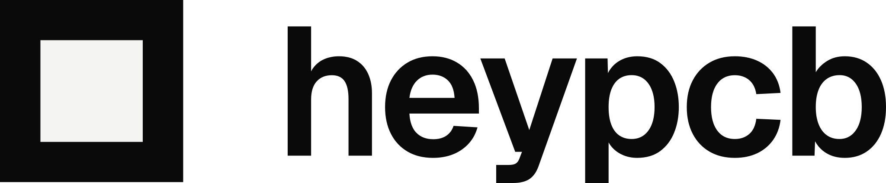
  </picture>
</a>

### Describe a circuit board. Get real KiCad files you keep.

HeyPCB is an AI PCB designer that runs in the browser. Tell Inky, our design
agent, what the board should do. Inky picks the parts, draws the schematic,
places and routes the board, and checks it with DRC, ERC and a circuit
simulation before calling it done. You keep the KiCad project, plus the
Gerbers, drill files, BOM, CPL and STEP a board house needs.

<p>
  <a href="https://heypcb.ai">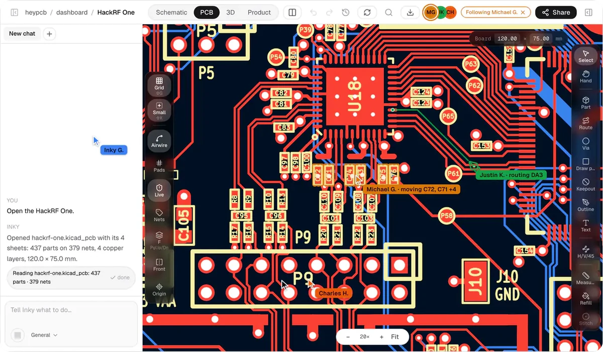</a>
  <a href="https://heypcb.ai">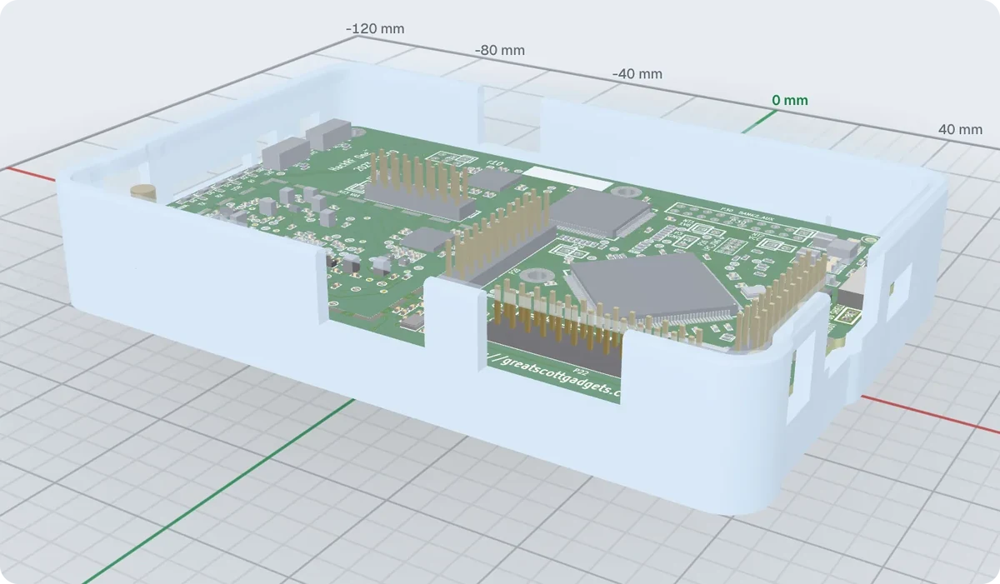</a>
</p>

<a href="https://github.com/HeyPCB/merch">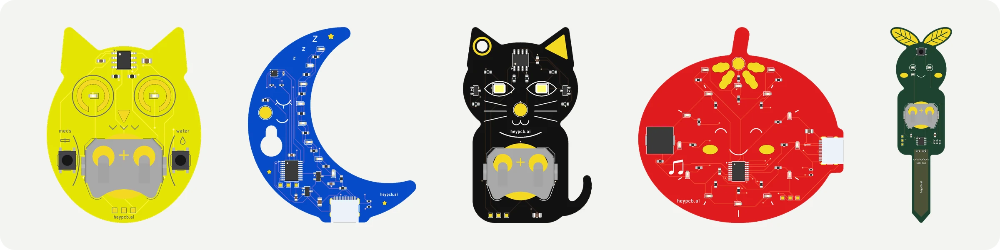</a>

<sub>Top: HackRF One by Great Scott Gadgets (CERN-OHL-P-2.0), opened, checked and cased in HeyPCB. Bottom: boards from our <a href="https://github.com/HeyPCB/merch">merch</a> set.</sub>

[](https://discord.gg/Qun7ZtY2Xy)&ensp;
[](https://x.com/heypcbai)&ensp;
[](https://www.npmjs.com/package/@heypcb/mcp)&ensp;
[](https://heypcb.ai/kicad)&ensp;
[](https://github.com/HeyPCB/heypcb-mcp)

<h3>

[Website](https://heypcb.ai) | [MCP server](https://heypcb.ai/mcp) | [KiCad plugin](https://heypcb.ai/kicad) | [Circuit World](https://heypcb.ai/world) | [Store](https://heypcb.ai/store) | [Blog](https://heypcb.ai/blog)

</h3>

</div>

## Design a board from your AI agent

Add HeyPCB to Claude Code:

```bash
claude mcp add --transport http --scope user heypcb https://api.heypcb.ai/mcp
```

or to Codex:

```bash
codex mcp add heypcb --url https://api.heypcb.ai/mcp && codex mcp login heypcb
```

Then ask for a board in plain words, for example *"a 40 × 20 mm USB-C board
with an ATtiny85, four WS2812B LEDs and a button"*. Inky builds it on
heypcb.ai and your agent can read, check and change it from there. Cursor and
claude.ai are on [heypcb.ai/mcp](https://heypcb.ai/mcp); the source is in
[heypcb-mcp](https://github.com/HeyPCB/heypcb-mcp).

## Where to use it

- **[heypcb.ai](https://heypcb.ai)**: the full editor, with schematic, PCB, 3D and enclosure, each editable by hand. Free trial, no card needed.
- **[AI agents (MCP)](https://heypcb.ai/mcp)**: design boards from Claude Code, Codex, Cursor or claude.ai.
- **[KiCad plugin](https://heypcb.ai/kicad)**: Inky beside the board open in KiCad 10's PCB Editor. In beta.

Also in the editor: [Multiplayer](https://heypcb.ai/multiplayer) (edit one
board together, live), [Time Machine](https://heypcb.ai/timemachine) (every
edit by you, your team or Inky, and any version brought back in one step) and
[Comment](https://heypcb.ai/comment) (pin a question to any spot on the
board).

## Open hardware from HeyPCB

These boards were designed with HeyPCB. Each repo has the KiCad 10 project,
and most include Gerbers, BOM and CPL. Each repo names its licence.

<table>
  <tr>
    <td width="33%" valign="top">
      <a href="https://github.com/HeyPCB/kestrel">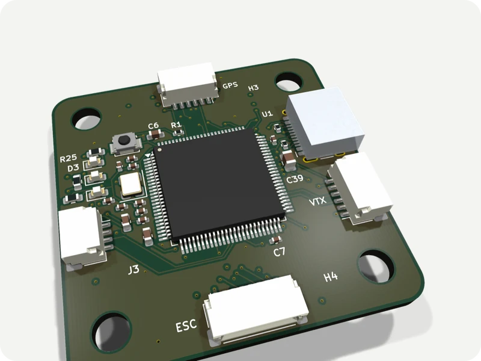</a>
      <br><b><a href="https://github.com/HeyPCB/kestrel">Kestrel</a></b>
      <br>Electronics for a 5-inch 6S FPV quad: an STM32H743 <a href="https://github.com/HeyPCB/kestrel-fc">flight controller</a>, a <a href="https://github.com/HeyPCB/kestrel-esc">4-in-1 ESC</a> running AM32 and a <a href="https://github.com/HeyPCB/kestrel-gps">GPS + compass</a>.
    </td>
    <td width="33%" valign="top">
      <a href="https://github.com/HeyPCB/iris">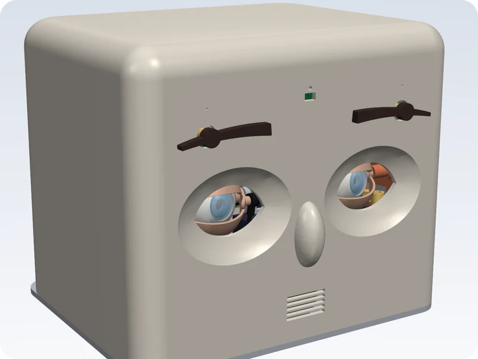</a>
      <br><b><a href="https://github.com/HeyPCB/iris">Iris</a></b>
      <br>A robot head with human-scale eyes, built from four boards: <a href="https://github.com/HeyPCB/iris-cortex">cortex</a>, <a href="https://github.com/HeyPCB/iris-brainstem">brainstem</a>, <a href="https://github.com/HeyPCB/iris-ring">ring</a> and <a href="https://github.com/HeyPCB/iris-brow">brow</a>.
    </td>
    <td width="33%" valign="top">
      <a href="https://github.com/HeyPCB/quack-core">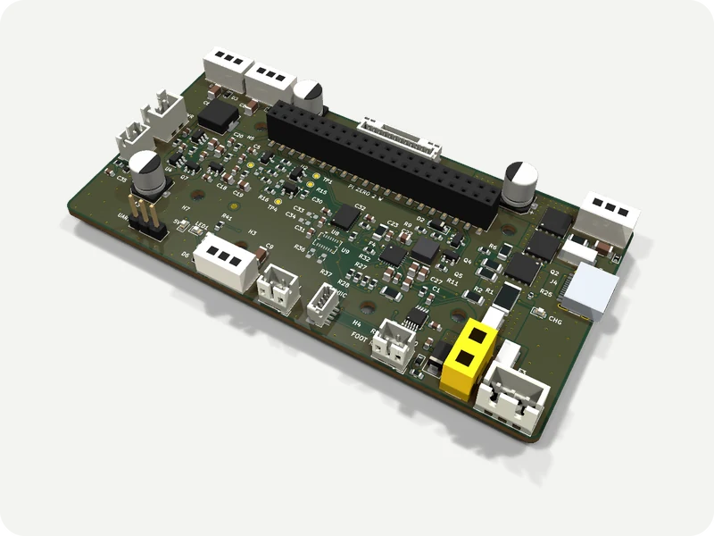</a>
      <br><b>Open Duck Mini</b>
      <br>Drop-in boards for the open-source robot duck: <a href="https://github.com/HeyPCB/quack-core">quack-core</a> (the brain), <a href="https://github.com/HeyPCB/quack-face">quack-face</a> and <a href="https://github.com/HeyPCB/knuckle">knuckle</a> (a gimbal-motor FOC driver).
    </td>
  </tr>
  <tr>
    <td valign="top">
      <a href="https://github.com/HeyPCB/whisker">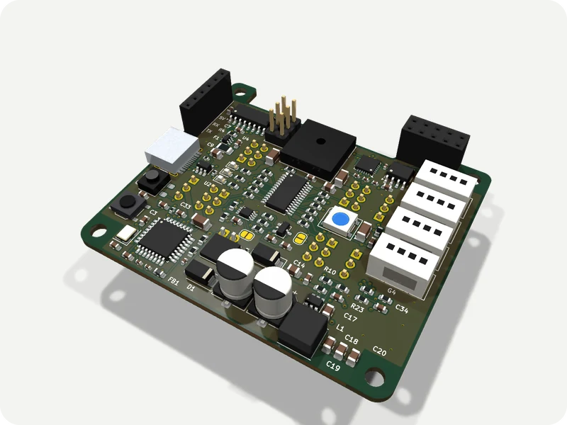</a>
      <br><b><a href="https://github.com/HeyPCB/whisker">Whisker</a></b>
      <br>A drop-in controller for Petoi's Nybble robot cat, running the stock OpenCat firmware.
    </td>
    <td valign="top">
      <a href="https://github.com/HeyPCB/hello-8051">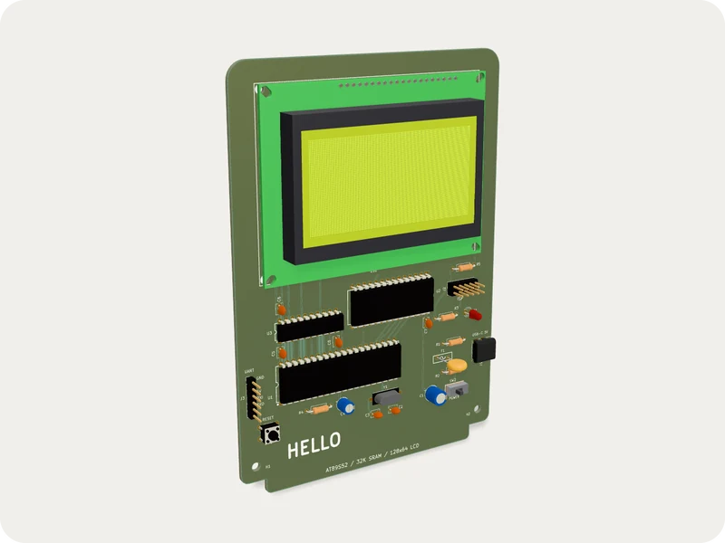</a>
      <br><b><a href="https://github.com/HeyPCB/hello-8051">hello-8051</a> · <a href="https://github.com/HeyPCB/esp32-s3-devkit">esp32-s3-devkit</a></b>
      <br>Boards built through our MCP server. HELLO is a tiny 8051 computer shaped like a 1984 desktop.
    </td>
    <td valign="top">
      <a href="https://github.com/HeyPCB/kestrel-esc">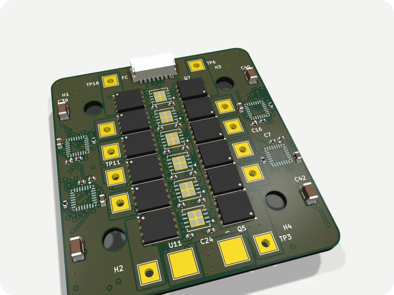</a>
      <br><b><a href="https://github.com/HeyPCB/kestrel-esc">Kestrel 4in1</a></b>
      <br>The quad's ESC: four STM32G071s running stock AM32 drive 24 CSD18540 FETs, with battery current sensing. 48 × 52 mm, six layers.
    </td>
  </tr>
  <tr>
    <td valign="top">
      <a href="https://github.com/HeyPCB/merch">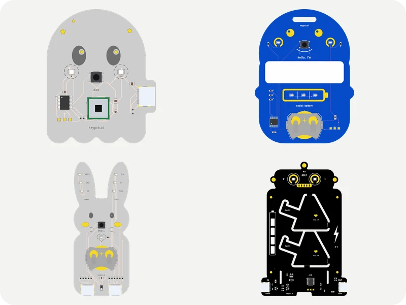</a>
      <br><b><a href="https://github.com/HeyPCB/merch">Merch</a></b>
      <br>Ten small, useful boards: <a href="https://github.com/HeyPCB/badge-blob">Blob</a>, <a href="https://github.com/HeyPCB/phone-robot">Bolt</a>, <a href="https://github.com/HeyPCB/fridge-owl">Hoot</a>, <a href="https://github.com/HeyPCB/ruler-dino">Ruler Dino</a>, <a href="https://github.com/HeyPCB/moon-light">Luna</a>, <a href="https://github.com/HeyPCB/air-ghost">Air Ghost</a>, <a href="https://github.com/HeyPCB/cable-bunny">Cable Bunny</a>, <a href="https://github.com/HeyPCB/torch-cat">Torch Cat</a>, <a href="https://github.com/HeyPCB/pomodoro-pal">Pomodoro Pal</a> and <a href="https://github.com/HeyPCB/plant-buddy">Sprout</a>.
    </td>
    <td valign="top">
      <a href="https://github.com/HeyPCB/power-kit">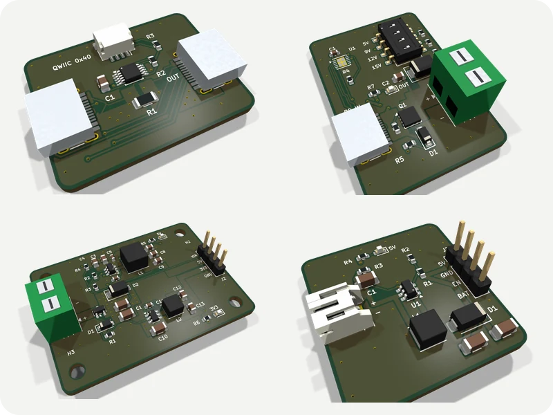</a>
      <br><b><a href="https://github.com/HeyPCB/power-kit">Power kit</a></b>
      <br>Six power and charging boards. Also: ESP32-S3 sensor boards, one sensor each (<a href="https://github.com/HeyPCB/esp32-sensors-1">part 1</a>, <a href="https://github.com/HeyPCB/esp32-sensors-2">part 2</a>).
    </td>
    <td valign="top">
      <a href="https://github.com/HeyPCB/led-art">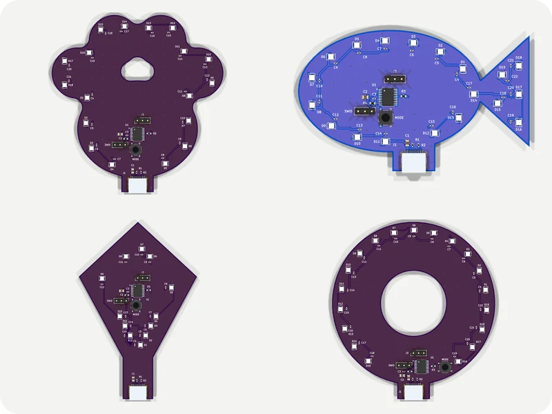</a>
      <br><b><a href="https://github.com/HeyPCB/led-art">LED art</a></b>
      <br>Shaped LED boards, each in its own colour (<a href="https://github.com/HeyPCB/led-art-2">part 2</a>).
    </td>
  </tr>
</table>

## Build a board, win a prize

The [HeyPCB Hardware Challenge](https://heypcb.ai/challenge) has $2,000 in
prizes: $1,000 for the most-liked board and $1,000 for the team's pick.
Entries close November 30, 2026 at 11:59 PM PT.

## Get in touch

- News and releases: [@heypcbai](https://x.com/heypcbai) on X and [HeyPCB on LinkedIn](https://www.linkedin.com/company/heypcb)
- Questions and builds: our [Discord](https://discord.gg/Qun7ZtY2Xy)
- Teams and enterprise: justin@heypcb.ai
- Logos and colours: the [brand kit](https://heypcb.ai/brand)
