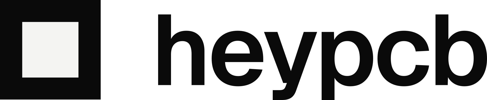

  <a href="https://heypcb.ai">
    <picture>
      <source media="(prefers-color-scheme: dark)" srcset="./assets/heypcb-lockup-white.svg">
      
    </picture>
  </a>

<b>Describe a circuit board. Get real KiCad files you keep.</b>

  <a href="https://heypcb.ai">Website</a> ·
  <a href="https://heypcb.ai/mcp">MCP server</a> ·
  <a href="https://heypcb.ai/kicad">KiCad plugin</a> ·
  <a href="https://heypcb.ai/blog">Blog</a> ·
  <a href="https://x.com/heypcbai">X</a> ·
  <a href="https://heypcb.ai/brand">Brand kit</a>

---

HeyPCB is an AI PCB designer that runs in the browser. You tell Inky, our
design agent, what the board should do. Inky picks the parts, draws the
schematic, places and routes the board, and checks it with DRC, ERC and a
circuit simulation before calling it done. You get the KiCad project plus the
Gerbers, drill files, BOM, CPL and STEP a board house needs. Every view
(schematic, PCB, 3D and enclosure) can also be edited by hand.

### Where to use it

| | |
|---|---|
| **[heypcb.ai](https://heypcb.ai)** | The full editor. Free trial, no card needed. |
| **[AI agents (MCP)](https://heypcb.ai/mcp)** | Design boards from Claude Code, Codex, Cursor or Claude. `claude mcp add --transport http heypcb https://api.heypcb.ai/mcp` · source in [heypcb-mcp](https://github.com/HeyPCB/heypcb-mcp) |
| **[KiCad plugin](https://heypcb.ai/kicad)** | Inky beside the board open in KiCad 10's PCB Editor. In beta. |

Also in the editor: [Multiplayer](https://heypcb.ai/multiplayer) (edit one
board together, live), [Time Machine](https://heypcb.ai/timemachine) (every
edit by you, your team or Inky, and any version brought back in one step) and
[Comment](https://heypcb.ai/comment) (pin a question to any spot on the
board).

### Open hardware from HeyPCB

These boards were designed with HeyPCB. Each repo has the KiCad 10
project, and most include Gerbers, BOM and CPL.

| Project | What it is |
|---|---|
| [Kestrel](https://github.com/HeyPCB/kestrel) | Electronics for a 5-inch 6S FPV quad: an STM32H743 [flight controller](https://github.com/HeyPCB/kestrel-fc), a [4-in-1 ESC](https://github.com/HeyPCB/kestrel-esc) running AM32 and a [GPS + compass](https://github.com/HeyPCB/kestrel-gps). |
| [Iris](https://github.com/HeyPCB/iris) | A robot head with human-scale eyes, built from four boards: [cortex](https://github.com/HeyPCB/iris-cortex), [brainstem](https://github.com/HeyPCB/iris-brainstem), [ring](https://github.com/HeyPCB/iris-ring) and [brow](https://github.com/HeyPCB/iris-brow). |
| Open Duck Mini | Drop-in boards for the open-source robot duck: [quack-core](https://github.com/HeyPCB/quack-core) (the brain), [quack-face](https://github.com/HeyPCB/quack-face) and [knuckle](https://github.com/HeyPCB/knuckle) (a gimbal-motor FOC driver). |
| [Whisker](https://github.com/HeyPCB/whisker) | A drop-in controller for Petoi's Nybble robot cat, running the stock OpenCat firmware. |
| [hello-8051](https://github.com/HeyPCB/hello-8051) · [esp32-s3-devkit](https://github.com/HeyPCB/esp32-s3-devkit) | Boards built through our MCP server. |
| [Merch](https://github.com/HeyPCB/merch) | Ten small, useful boards: [Blob](https://github.com/HeyPCB/badge-blob), [Bolt](https://github.com/HeyPCB/phone-robot), [Hoot](https://github.com/HeyPCB/fridge-owl), [Ruler Dino](https://github.com/HeyPCB/ruler-dino), [Luna](https://github.com/HeyPCB/moon-light), [Air Ghost](https://github.com/HeyPCB/air-ghost), [Cable Bunny](https://github.com/HeyPCB/cable-bunny), [Torch Cat](https://github.com/HeyPCB/torch-cat), [Pomodoro Pal](https://github.com/HeyPCB/pomodoro-pal) and [Sprout](https://github.com/HeyPCB/plant-buddy). |
| Starter sets | [ESP32-S3 sensor boards](https://github.com/HeyPCB/esp32-sensors-1) ([part 2](https://github.com/HeyPCB/esp32-sensors-2)), a [power and charging kit](https://github.com/HeyPCB/power-kit), and shaped [LED art](https://github.com/HeyPCB/led-art) ([part 2](https://github.com/HeyPCB/led-art-2)). |

Our dev boards (Red Eyes, Exodia and Charizard) are open source too, with
KiCad files, Gerbers and BOM on the [store](https://heypcb.ai/store).
Each repo names its licence.

### Build a board, win a prize

The [HeyPCB Hardware Challenge](https://heypcb.ai/challenge) has $2,000 in
prizes: $1,000 for the most-liked board and $1,000 for the team's pick.
Entries close November 30, 2026 at 11:59 PM PT.

### Get in touch

News and releases: [@heypcbai](https://x.com/heypcbai) · Teams and
enterprise: justin@heypcb.ai
